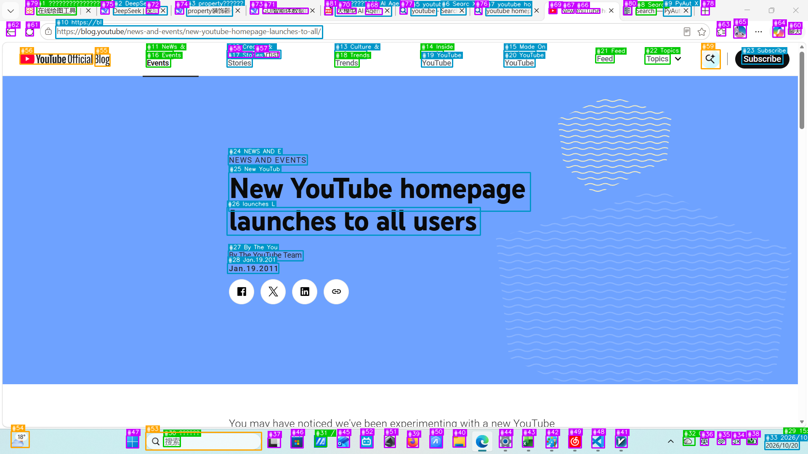

# ScreenElementExtractor 功能验证

## **原图**


## **验证图**


## **UI元素列表**(部分): 
```json
{
  "screenshot_size": [1920, 1080],
  "element_count": 81,
  "elements": [
    {
      "bbox": [87, 15, 181, 35],
      "text": "在线绘图工具",
      "confidence": 0.5561,
      "source": "ocr",
      "element_id": 1,
      "type": "button",
      "center": [134, 25]
    },
    {
      "bbox": [269, 15, 397, 35],
      "text": "DeepSeek | 深度 X",
      "confidence": 0.5848,
      "source": "ocr",
      "element_id": 2,
      "type": "text",
      "center": [333, 25]
    }
  ]
}
```
**检出元素数**：**81 个**

**类型分布：**

| 元素类型 | 颜色 | 数量 |
|----------|------|------|
| `button`（按钮） | 🟢 绿色 | 11 |
| `text`（文本） | 🔵 蓝色 | 20 |
| `input`（输入框） | 🟠 橙色 | 6 |
| `icon`（图标） | 🟣 紫红色 | 44 |
| **合计** | | **81** |

**来源分布：**

| 来源 | 数量 |
|------|------|
| OCR 文字识别 | 33 |
| OpenCV 轮廓检测 | 48 |


