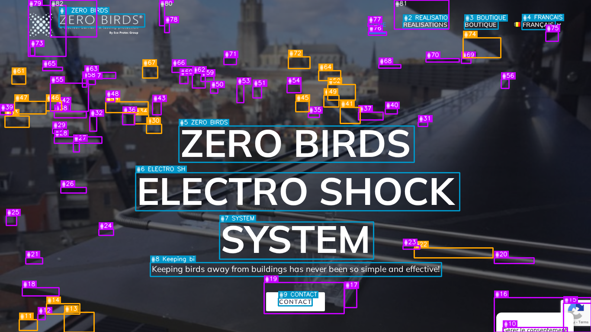
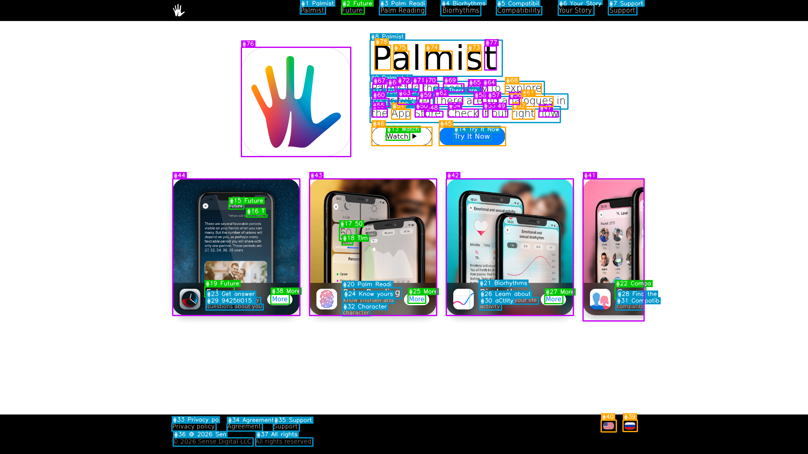
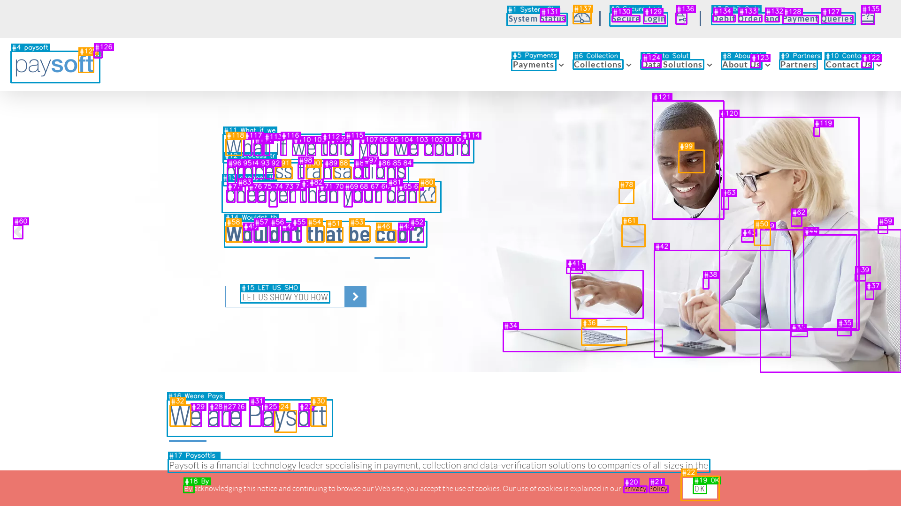

# 屏幕元素提取模块 (ScreenElementExtractor) 测试报告

**测试对象**：`ScreenElementExtractor` (基于 EasyOCR + OpenCV 的 UI 元素检测模块)

**测试数据集**：`docling-project/screenparse` (前 100 张截图)

## 一、 测试目标与运行环境
本次测试旨在对 `ScreenElementExtractor` 模块进行首轮初步验证，重点检验其：
1. 能否在真实屏幕截图数据集上稳定运行，不出现崩溃或中断；
2. 数据格式转换逻辑（PIL 转 OpenCV BGR）是否正确无误；
3. 初步评估视觉检测与 OCR 结合的元素提取数量与真实标注数量的差异。

* 数据加载方式：Hugging Face 数据集流式加载（Streaming 模式）

## 二、 测试执行情况
本次测试共流式读取了数据集的前 100 张图片，并调用 `process_cv_image` 核心接口进行检测。整个过程模块运行稳定，未发生任何代码层面的异常崩溃，内存转换与模型推理流程完全贯通。

### 2.1 性能耗时统计
* 总处理图片数：100 张
* 总耗时：553.90 秒
* 平均单张耗时：约 5.54 秒/张

### 2.2 检测数量统计比对
| 统计维度 | 数量总计 | 平均每张图数量 |
| :--- | :--- | :--- |
| 真实标注总数 (Ground Truth) | 2152 个 | 约 21.5 个/图 |
| 模块预测总数 (Predictions) | 5909 个 | 约 59.1 个/图 |

## 三、输出结果可视化










## 四、 测试结果分析

通过对日志数据的逐行对比，发现模块在当前的逻辑下存在**非常严重的“过度检测”问题**：

1. 预测数量远超真实标注：
   在 100 张图中，绝大多数图片的预测数量是真实数量的 **2 到 5 倍**，某些极端图片（如第 52 张、第 66 张、第 97 张）预测数量达到了 100~300 个，而真实标注仅有 12~28 个。
2. 极个别漏检现象：
   在第 5 张（预测 17 / 真实 24）、第 17 张（预测 44 / 真实 47）、第 48 张（预测 27 / 真实 221）中，预测数量少于真实数量，尤其是第 48 张出现了极大规模的漏检。
3. 原因定位：
   当前模块中的 **OpenCV 轮廓检测 (`_run_visual_detect`)** 逻辑对屏幕截图过于敏感。`adaptiveThreshold` 将文字边缘、背景线条、甚至是阴影全部提取成了轮廓，导致大量的无用背景被判定为 `icon` 或 `input` 元素并绘制了边框。

## 五、 下一步优化

增加深度学习检测模型：纯传统视觉算法（OpenCV）很难区分屏幕截图中的“UI 元素”和“装饰性纹理”。后续可考虑引入专门做 UI 元素定位的多模态大模型。

## 附录：第一轮自动化测试运行日志
```text
初始化模型...
Using CPU. Note: This module is much faster with a GPU.
流式加载数据集前 100 张图...
Resolving data files: 100%|█████████████| 1448/1448 [00:00<00:00, 35734.01it/s]
[001/100] 预测: 82 个 | 真实: 12 个
[002/100] 预测: 78 个 | 真实: 36 个
[003/100] 预测: 30 个 | 真实: 19 个
[004/100] 预测: 137 个 | 真实: 30 个
[005/100] 预测: 17 个 | 真实: 24 个
[006/100] 预测: 23 个 | 真实: 13 个
[007/100] 预测: 74 个 | 真实: 19 个
[008/100] 预测: 115 个 | 真实: 32 个
[009/100] 预测: 56 个 | 真实: 19 个
[010/100] 预测: 52 个 | 真实: 13 个
[011/100] 预测: 11 个 | 真实:  8 个
[012/100] 预测: 67 个 | 真实: 15 个
[013/100] 预测: 59 个 | 真实: 38 个
[014/100] 预测: 45 个 | 真实:  4 个
[015/100] 预测: 58 个 | 真实: 37 个
[016/100] 预测: 21 个 | 真实: 11 个
[017/100] 预测: 44 个 | 真实: 47 个
[018/100] 预测: 55 个 | 真实: 21 个
[019/100] 预测: 82 个 | 真实: 13 个
[020/100] 预测: 42 个 | 真实:  4 个
[021/100] 预测: 102 个 | 真实: 32 个
[022/100] 预测: 10 个 | 真实:  3 个
[023/100] 预测: 104 个 | 真实: 32 个
[024/100] 预测: 27 个 | 真实: 18 个
[025/100] 预测: 44 个 | 真实: 20 个
[026/100] 预测: 33 个 | 真实: 17 个
[027/100] 预测: 14 个 | 真实: 17 个
[028/100] 预测: 111 个 | 真实: 32 个
[029/100] 预测: 77 个 | 真实: 42 个
[030/100] 预测: 86 个 | 真实: 30 个
[031/100] 预测: 127 个 | 真实: 27 个
[032/100] 预测: 13 个 | 真实:  9 个
[033/100] 预测: 24 个 | 真实: 13 个
[034/100] 预测: 69 个 | 真实: 16 个
[035/100] 预测: 90 个 | 真实: 30 个
[036/100] 预测: 21 个 | 真实: 11 个
[037/100] 预测: 94 个 | 真实: 17 个
[038/100] 预测: 141 个 | 真实: 23 个
[039/100] 预测: 27 个 | 真实: 15 个
[040/100] 预测: 74 个 | 真实: 10 个
[041/100] 预测: 57 个 | 真实: 19 个
[042/100] 预测: 141 个 | 真实: 10 个
[043/100] 预测: 28 个 | 真实: 12 个
[044/100] 预测: 31 个 | 真实: 19 个
[045/100] 预测: 72 个 | 真实: 12 个
[046/100] 预测: 140 个 | 真实: 35 个
[047/100] 预测: 23 个 | 真实: 16 个
[048/100] 预测: 27 个 | 真实: 221 个
[049/100] 预测: 18 个 | 真实: 16 个
[050/100] 预测: 124 个 | 真实: 54 个
[051/100] 预测:  9 个 | 真实:  8 个
[052/100] 预测: 300 个 | 真实: 22 个
[053/100] 预测: 34 个 | 真实: 27 个
[054/100] 预测: 35 个 | 真实: 10 个
[055/100] 预测: 56 个 | 真实: 28 个
[056/100] 预测: 30 个 | 真实: 45 个
[057/100] 预测: 92 个 | 真实: 25 个
[058/100] 预测: 16 个 | 真实: 18 个
[059/100] 预测: 18 个 | 真实:  4 个
[060/100] 预测: 34 个 | 真实: 12 个
[061/100] 预测: 12 个 | 真实: 12 个
[062/100] 预测: 25 个 | 真实: 13 个
[063/100] 预测: 83 个 | 真实: 38 个
[064/100] 预测: 16 个 | 真实: 16 个
[065/100] 预测: 34 个 | 真实: 12 个
[066/100] 预测: 187 个 | 真实: 12 个
[067/100] 预测: 23 个 | 真实: 17 个
[068/100] 预测: 81 个 | 真实: 32 个
[069/100] 预测: 36 个 | 真实:  1 个
[070/100] 预测: 63 个 | 真实: 18 个
[071/100] 预测: 124 个 | 真实: 90 个
[072/100] 预测: 62 个 | 真实: 35 个
[073/100] 预测: 23 个 | 真实: 16 个
[074/100] 预测:  4 个 | 真实:  1 个
[075/100] 预测: 80 个 | 真实: 14 个
[076/100] 预测: 51 个 | 真实: 10 个
[077/100] 预测: 75 个 | 真实:  7 个
[078/100] 预测: 93 个 | 真实: 15 个
[079/100] 预测: 141 个 | 真实: 18 个
[080/100] 预测: 35 个 | 真实: 18 个
[081/100] 预测: 18 个 | 真实:  9 个
[082/100] 预测: 19 个 | 真实: 10 个
[083/100] 预测: 19 个 | 真实: 12 个
[084/100] 预测: 26 个 | 真实: 15 个
[085/100] 预测: 46 个 | 真实:  4 个
[086/100] 预测: 26 个 | 真实: 14 个
[087/100] 预测: 97 个 | 真实: 16 个
[088/100] 预测: 51 个 | 真实: 18 个
[089/100] 预测:  9 个 | 真实:  6 个
[090/100] 预测: 59 个 | 真实:  9 个
[091/100] 预测: 40 个 | 真实: 28 个
[092/100] 预测: 78 个 | 真实: 30 个
[093/100] 预测: 48 个 | 真实: 25 个
[094/100] 预测: 46 个 | 真实: 15 个
[095/100] 预测: 21 个 | 真实: 13 个
[096/100] 预测: 66 个 | 真实: 14 个
[097/100] 预测: 146 个 | 真实: 28 个
[098/100] 预测: 65 个 | 真实: 12 个
[099/100] 预测: 18 个 | 真实:  4 个
[100/100] 预测: 42 个 | 真实: 33 个

========================================
测试完成！共处理 100 张图
总耗时: 553.90 秒 (平均 5.54 秒/张)
真实标注总数: 2152 个
模型预测总数: 5909 个
========================================
```