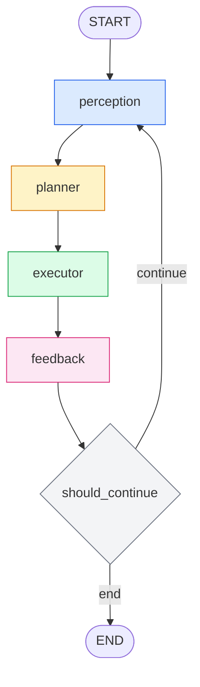

# 第 3 周周报

## 一、本周工作

### 1. 基于 LangGraph 搭建多模态 Agent 框架

<div align="center">



</div>

上图对应 `graph.py` 中 `build_graph()` 编译后的 LangGraph 拓扑。整个 Agent 以 `perception` 为入口，按"感知 → 规划 → 执行 → 反馈"的顺序串行推进，再由条件边决定是回到感知开始下一轮，还是结束任务。

#### 1.1 四个节点的分工

| 节点 | 职责 |
|---|---|
| **perception** | 每轮循环的起点。调用 `ActionDispatcher` 对电脑屏幕截图，再把原始图片交给 `ScreenElementExtractor` 做文字识别和 UI 元素轮廓检测，最终产出两部分内容：一是 UI 元素列表（每个元素包含名称、类型、边界框等信息），二是把 UI 元素边界框标注到原图上的可视化图片。 |
| **planner** | 负责每轮的决策。它先把当前 UI 元素列表、历史轨迹和上一步执行结果整理成一段文本，再连同标注后的可视化图片一起，作为多模态消息发给千问2.5-VL。模型通过结构化输出直接返回一个 `ActionSchema` 格式的动作，planner 将其写入 `last_action`，并把当前步数加一。 |
| **executor** | 负责把决策真正执行到电脑上。它先根据动作里引用的 `element_id` 查出对应元素的中心坐标，清理掉空字段后交给 `ActionDispatcher.dispatch` 执行。如果动作是 `finish`，则在此直接拦截，把 `finished` 置为 `True`，不再调用底层。无论成功还是异常，执行结果都会写入 `last_result` 和 `history`。 |
| **feedback** | 负责每轮执行后的检查。它先做规则判断：如果 `last_result` 是 error，就把错误信息传给下一轮的 planner，让它调整策略；如果执行正常，则可选地调用 VL 模型看一眼执行后的画面，做一次简短反思，帮助下一轮决策。 |

#### 1.2 条件边的退出策略

`should_continue` 在 feedback 之后检查三个退出条件：任务是否已完成（`finished=True`）、步数是否达到上限（`max_steps`）、是否带错误且步数耗尽。任一条件满足就走向 `END` 结束任务，否则返回 `continue`，回到 perception 开启下一轮循环。

#### 1.3 核心数据结构与提示词设计

本框架的运行时行为由三份声明式定义共同约束：
- **AgentState** 定义整个循环共享的状态容器
- **ActionSchema** 定义规划层与执行层之间的动作契约
- **提示词模板**定义模型的行为规范与每轮上下文。

**（1）AgentState 字段说明**

| 字段 | 类型 | 说明 |
|---|---|---|
| `goal` | `str` | 用户下发的任务目标，整个生命周期不变 |
| `messages` | `Annotated[list, add_messages]` | 对话与反思历史，由 LangGraph 的 `add_messages` reducer 累积 |
| `step` | `int` | 当前步数，由 planner 每轮递增 |
| `screenshot` | `Optional[bytes]` | 当前全屏截图（PNG bytes），由 perception 每轮覆盖写入 |
| `elements` | `List[dict]` | 感知得到的 UI 元素列表，每个元素含名称、类型、边界框、中心坐标等 |
| `vis_image` | `Optional[bytes]` | 将元素边界框标注到原图上的可视化图（PNG bytes），供多模态模型使用 |
| `last_action` | `Optional[dict]` | planner 上一轮产出的结构化动作（`ActionSchema` 的 dict 形式） |
| `last_result` | `Optional[dict]` | executor 执行结果，成功为 `{"type": "ok"}`，失败为 `{"type": "error", "error": ...}` |
| `history` | `List[dict]` | 完整轨迹，每步记录 `{step, action, result, error}`，由 executor 追加 |
| `finished` | `bool` | 任务是否结束，由 executor（遇到 `finish`）和 `should_continue` 共同判定 |
| `error` | `Optional[str]` | 从 `last_result` 提取的错误信息，供重试判定使用 |

**（2）ActionSchema 字段说明**

| 字段 | 类型 | 说明 |
|---|---|---|
| `type` | `Literal[...]` | 动作类型，限定为 `left_click` / `right_click` / `left_double_click` / `mouse_move` / `scroll` / `left_click_drag` / `type_text` / `key_press` / `key_down` / `key_up` / `wait` / `finish` |
| `x` | `Optional[int]` | 目标 x 坐标，点击/移动时与 `y` 成对出现 |
| `y` | `Optional[int]` | 目标 y 坐标 |
| `text` | `Optional[str]` | `type_text` 动作要输入的文本 |
| `key` | `Optional[str]` | `key_press` / `key_down` / `key_up` 的按键名 |
| `direction` | `Optional[Literal["up","down","left","right"]]` | `scroll` 的滚动方向 |
| `amount` | `Optional[float]` | `scroll` 的滚动量 |
| `end_x` | `Optional[int]` | `left_click_drag` 的终点 x 坐标 |
| `end_y` | `Optional[int]` | `left_click_drag` 的终点 y 坐标 |
| `element_id` | `Optional[int]` | 引用感知元素时填其编号，executor 会解析为元素中心坐标 |
| `reasoning` | `str` | 选择该动作的理由，写入轨迹供复盘 |

**（3）系统提示词结构说明**

| 部分 | 内容 | 作用 |
|---|---|---|
| 角色定义 | "You are a GUI automation agent running on a real computer." | 设定模型身份与运行环境 |
| 规则 1 | 只能输出 JSON，格式见 `ActionSchema` | 约束输出结构，配合 `with_structured_output` 双重校验 |
| 规则 2 | 优先通过 `element_id` 引用元素，系统解析为中心坐标 | 把坐标计算从模型侧转移到代码侧，降低幻觉 |
| 规则 3 | 需要精确坐标时直接给 `x/y` | 覆盖无对应感知元素的场景 |
| 规则 4 | 动作必须原子化，一次只做一个 | 保证执行结果与反馈判断一一对应，失败可精确定位 |
| 规则 5 | 任务完成时输出 `type="finish"` | executor 拦截并置 `finished=True` 的唯一信号 |
| 规则 6 | 动作失败时分析原因，换方式重试 | 配合 `{last_result}` 注入，形成反馈闭环 |
| 可用动作 | 列出每个动作及必填参数 | 提供动作空间白名单，减少结构化输出校验失败 |
| `PLANNER_USER_TEMPLATE` | 目标 → 进度 → 当前元素 → 上一步结果 → 历史摘要 | 每轮注入的动态上下文，先全局后局部 |
| `REFLECT_PROMPT` | 是否达成预期、原因、下一步调整，一两句话回答 | 语义层反馈使用，控制 token 消耗 |


## 2. 大模型调用接口开发

| 项目 | 内容 |
|---|---|
| 模型 | 千问2.5-VL（Qwen2.5-VL） |
| 模型 ID | `Qwen/Qwen2.5-VL-7B-Instruct`（通过环境变量 `VLM_MODEL_ID` 配置，可切换 72B 等版本） |
| 调用平台 | 模搭社区（ModelScope）推理服务 |
| API 地址 | `https://api-inference.modelscope.cn/v1/` |
| API Key | 模搭社区（ModelScope）的 API Key，通过环境变量 `MODELSCOPE_API_KEY` 注入 |
| 协议 | OpenAI Chat Completions 兼容协议 |
| LangChain 封装 | `ChatOpenAI(model=..., base_url=..., api_key=...)` |
| 多模态输入 | 文本 + base64 data URL 图片，通过 `HumanMessage(content=[...])` 构造 |
| 结构化输出 | `with_structured_output(ActionSchema)` 强制返回 Pydantic 动作对象 |

补充说明：

- **平台**：千问2.5-VL 的调用走的是**模搭社区（ModelScope）**的推理 API。模搭社区提供了 OpenAI 兼容的端点，所以可以直接复用 LangChain 的 `ChatOpenAI`，只需替换 `base_url` 和 `api_key`。
- **API Key 来源**：`MODELSCOPE_API_KEY` 需要在模搭社区（modelscope.cn）个人中心获取，写入项目`src/`文件夹下的 `.env` 文件，由 `config.py` 在启动时通过 `load_dotenv()` 读取。
- **模型可切换**：`VLM_MODEL_ID` 默认指向 `Qwen/Qwen2.5-VL-7B-Instruct`，如需换成 72B 或其他版本，只改环境变量即可，代码无需改动。


## 3. 公开 GUI 任务数据集下载与预处理

三个数据集在来源和形态上差异明显：Mind2Web 直接托管在 HuggingFace，ScreenAgent 需要从 GitHub 拉取仓库后本地复制，WebArena-Verified 虽然也在 HuggingFace 上，但本质是评测专用数据集，真正的价值在于环境搭建和实际运行。下面逐个说明。

### 2.1 ScreenAgent：本地复制 + 代码适配

ScreenAgent 没有在 HuggingFace 上发布官方数据集，数据以文件夹形式放在官方 GitHub 仓库中。处理分三步：

**第一步，拉取仓库并复制数据。** 把 ScreenAgent 项目代码库 clone 到本地，找到其中的 `data/ScreenAgent/` 目录，整个复制到自己的项目里：

**第二步，写数据适配器。** 在 `gui_agent/data/screenagent.py` 中实现遍历逻辑：逐个 session 读取 JSON 标注，提取任务指令、图片文件名、动作序列和分辨率信息，拼出图片的完整路径并读入二进制，最终产出统一的 `UnifiedSample` 结构。

**第三步，字段探测与格式统一。** ScreenAgent 不同版本的 JSON 字段名可能不一致，适配器不硬编码字段，而是按候选列表逐个尝试：


### 2.2 Mind2Web：HuggingFace 直接加载 + 字段适配

Mind2Web 在 HuggingFace 上有官方数据集，多模态场景使用 `osunlp/Multimodal-Mind2Web`，该版本已将 HTML 与截图对齐。直接用 `datasets` 库加载即可：

```python
from datasets import load_dataset
ds = load_dataset("osunlp/Multimodal-Mind2Web", split="train")
```

加载后的字段适配是这一步的主要工作：

| 原始字段 | 实际形态 | 适配方式 |
|---|---|---|
| `screenshot` | 官方定义为路径字符串，`datasets` 加载后可能为 `PIL.Image` 或 `str` | 运行时先确认类型，再分支处理：`PIL.Image` 直接转 PNG bytes，`str` 路径保留在 `image_path` |
| `operation` | 嵌套在 `actions` 列表内，含 `op` 与 `value` | 取 `row["actions"][0]["operation"]`，再映射到 `ActionSchema` |
| `confirmed_task` | 字符串 | 直接作为 `instruction` |

动作映射规则：`CLICK → left_click`、`TYPE → type_text`、`SELECT → left_click`。映射逻辑集中在 `common.py` 的 `normalize_action(raw, source="mind2web")` 中。

### 2.3 WebArena-Verified：评测专用 + 环境搭建

这里使用的是 WebArena 的验证版本 WebArena-Verified，它在 HuggingFace 上可直接获取：

```python
from datasets import load_dataset
ds = load_dataset("AmineHA/WebArena-Verified", split="full")  # 812 条
# 或 split="hard"（258 条）
```

**它和另外两个数据集有本质区别：测试专用。** 字段里只有任务定义和评测规则，没有截图，也没有人类标注的动作序列：

| 字段 | 类型 | 说明 |
|---|---|---|
| `intent` | `str` | 用户任务指令 |
| `eval` | `str` | 评测规则，运行时解析后用于打分 |
| `start_urls` | `List[str]` | 任务起始页面 |
| `sites` | `List[str]` | 涉及的站点（shopping、reddit、gitlab 等） |
| `task_id` | `int64` | 任务编号 |

**比数据集更重要的是环境搭建。** WebArena-Verified 的评测依赖各站点的 Docker 环境。完整流程是：

1. 根据任务的 `sites` 字段，启动对应的站点容器（shopping、reddit、gitlab 等）；
2. 自己的 Agent 从 `start_urls` 开始，在真实浏览器环境里感知、规划、执行；
3. Agent 运行结束后，用任务的 `eval` 规则判定是否达成目标；
4. 汇总所有任务的评测结果。

WebArena 这部分的工作量主要不在数据预处理，而在**环境编排 + Agent 实际运行 + 结果评估**这条评测链路上。适配器只是把 HF 上的任务定义读进来，真正的价值在于让 Agent 在真实环境中跑起来并产生可评估的行为。

### 2.4 统一输出

三个适配器最终都输出 `UnifiedSample`，定义在 `gui_agent/data/common.py`：

| 字段 | 类型 | 说明 |
|---|---|---|
| `image_bytes` | `Optional[bytes]` | 截图二进制；WebArena 为 `None` |
| `image_path` | `Optional[str]` | 图片路径 |
| `instruction` | `str` | 任务指令 |
| `action` | `dict` | 已归一化为 `ActionSchema` 格式；WebArena 为空 |
| `source` | `str` | 数据来源标识 |
| `metadata` | `dict` | 数据集特有字段 |

## 三、本周产出

### 3.1 Agent 框架搭建

框架代码位于项目 `src/` 目录下，复用第二周已完成的感知与执行模块。

| 文件路径 | 功能描述 |
|---|---|
| `src/agent.py` | 对外入口，封装图编译与任务调用 |
| `src/graph.py` | LangGraph 编排，把四个节点连成循环并定义退出条件 |
| `src/perception.py` | 感知节点，截图后做 OCR 与轮廓检测，产出元素列表和标注图 |
| `src/planner.py` | 规划节点，调用千问2.5-VL 产出结构化动作并更新步数 |
| `src/executor.py` | 执行节点，解析坐标后调用底层执行并记录结果 |
| `src/feedback.py` | 反馈节点，把执行错误传给下一轮，可选调用 VL 模型做执行后反思 |
| `src/state.py` | 定义共享状态 `AgentState` 与动作契约 `ActionSchema` |
| `src/prompts.py` | 系统提示词、规划提示词、反思提示词三份模板 |
| `src/llm.py` | 大模型调用封装，对接模搭社区千问2.5-VL，构造多模态消息 |
| `src/config.py` | 全局配置，管理模型 ID、API Key 注入等参数 |

### 3.2 公开数据集下载与预处理

数据集代码在项目 `data/` 目录下，三个数据集各一个适配器，统一输出 `UnifiedSample` 结构。

| 文件路径 | 功能描述 |
|---|---|
| `data/common.py` | 定义统一数据格式，实现跨数据集动作归一化 |
| `data/screenagent.py` | ScreenAgent 适配器，遍历本地目录、读出图片和动作 |
| `data/mind2web.py` | Mind2Web 适配器，加载 HF 数据集，解析截图与嵌套动作字段 |
| `data/webarena.py` | WebArena-Verified 适配器，加载任务定义供评测使用 |
| `data/screenagent_raw/` | 从 ScreenAgent 仓库复制的原始数据 |

### 3.4 仓库更新

GitHub 仓库：https://github.com/dhebhxh/gui-agent

## 三、遇到的问题与解决

### 3.1 数据集形态差异大，难以统一处理

问题：三个数据集的 HuggingFace 可用程度、字段结构、是否含截图与动作标注均不一致，无法用同一套加载逻辑处理

解决：按“静态标注数据集 / 本地文件夹数据集 / 评测型数据集”三类分别编写适配器，统一输出 `UnifiedSample`；动作空间通过 `normalize_action` 做归一化映射；WebArena 明确仅用于评测，不参与训练数据构建

## 四、下周计划

### 第 4 周：端到端 GUI 任务执行系统集成

| 模块 | 任务 |
|------|------|
| 模块集成 | 将感知模块、控制模块与 Agent 框架进行无缝集成 |
| 闭环执行 | 实现“用户指令 → 屏幕感知 → 任务规划 → 动作执行 → 结果反馈”的完整闭环 |
| 命令行界面 | 开发简单的命令行交互界面 |
| 基础任务测试 | 测试并调试 5 个基础桌面任务：打开浏览器、搜索指定内容、打开指定文件、发送消息、关闭应用 |

**下周交付物**：端到端 GUI 智能体系统原型 v1.0 + 基础任务测试报告