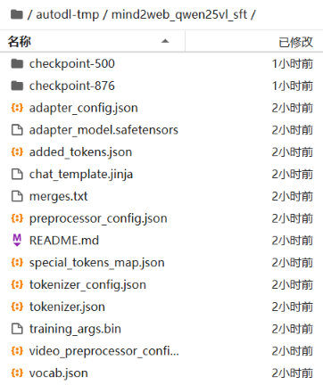

# 第五周周报

## 一、本周概述

本周工作围绕“构建微调数据集与大模型微调”展开，主要完成四件事：

- 将项目迁移到 AutoDL 无头服务器并打通远程截图/执行通道
- 重构规划节点与短期记忆
- 按 SFT 训练器格式重新清洗 multimodal-mind2web 数据集
- 完成微调代码编写并成功跑通一次完整微调

本周结束时，已得到一版基于 Qwen2.5-VL-7B-Instruct 的 LoRA 适配器，总训练步数 876 步。

---

## 二、技术学习：PEFT 与 TRL

本周首先补了微调相关的库文档。

### 2.1 PEFT

PEFT 是参数高效微调库，核心是冻结基模大部分参数、只训练少量额外参数，其中 LoRA 是最常用的方法。官方文档把参数高效微调方法分为三类：

- **Soft prompting**：在输入侧拼接可学习的“软提示”向量，和输入 embedding 一起优化。优点是极省参数，缺点是不可读、不直观。
- **Layer tuning**：只针对某一类层或层的某个方面做调整，比如只调 LayerNorm 层，或只调 embedding 矩阵中的特定 token。
- **Adapter methods**：在模型内部插入小的可训练矩阵来引导大模型适配下游任务。LoRA 是其中最常见的一种，用低秩分解的方式减少参数量。

本项目选 LoRA 属于第三类 adapter methods，因为它在表达能力和资源节省之间平衡得比较好，也是目前 VLM 微调里最常用的方案。

LoRA 支持多模态模型训练，NVIDIA 文档列出的经测试支持 LoRA 微调的 VLM 中即包含 Qwen2.5-VL 系列。在模块选择上，LoRA 一般作用于注意力模块的 q/k/v/o 四个投影层；是否扩展到 MLP 的 gate/up/down 三个投影层取决于任务需求与显存预算，扩展后容量更大但更吃显存。本项目采用覆盖注意力与 MLP 共七个投影层的配置。

### 2.2 TRL

TRL 是 Hugging Face 的训练库，提供 SFTTrainer 等组件，把监督微调的流程封装成可直接调用的训练器。

TRL 的 SFTTrainer 对数据集格式有明确要求，这是数据清洗必须对齐的硬性约束。官方文档将数据集按格式和类型两个维度划分：

- **格式**：标准格式使用普通文本列，对话式格式使用带 role 和 content 的消息列表。
- **类型**：SFTTrainer 支持 language modeling 和 prompt completion 等多类，前者使用整段文本或完整消息序列，后者使用分开的 prompt 与 completion 列。

本项目选对话式格式和 prompt completion，因为根据官方文档，这两种的多模态训练效果最好。

---

## 三、工作一：项目迁移到 AutoDL 无头服务器与远程控制通道

为了后续微调和推理方便，把项目搬到了 AutoDL 无头服务器上。由于服务器没有显示器，思路是：AutoDL 侧每次推理时向我的电脑发起截图请求，本地电脑执行截图并返回；AutoDL 收到截图后运行 agent 循环代码，输出一个动作，动作再传回本地电脑，由本地执行器执行并返回结果。两端通过 SSH 隧道传输，本地电脑作为服务端监听截图/执行请求，AutoDL 作为客户端运行 agent 代码与推理任务。

为此在 `/app` 目录下写了服务端与客户端代码，框架选用 FastAPI，并学习了其官方文档的核心用法。服务端核心接口如下：

```python
@app.get("/screenshot")
def get_screenshot():
    result = dispatcher.dispatch({"type": "screenshot"})
    img_base64 = base64.b64encode(result["data"]).decode("utf-8")
    return {"status": "success", "image_base64": img_base64}

@app.post("/execute")
def execute_action(req: ActionRequest):
    result = dispatcher.dispatch(req.action)
    return {"status": "success", "result": result}
```

客户端侧只是把感知节点和执行节点中的本地操作改为向另一台机器发请求：

```python
# perception.py
resp = requests.get(f"{LOCAL_SERVER_URL}/screenshot")
png = base64.b64decode(resp.json()["image_base64"])

# executor.py
resp = requests.post(f"{LOCAL_SERVER_URL}/execute", json={"action": action}, timeout=10)
```

另外还写了 `test_client.py` 客户端测试代码，在远程机器上真实跑了一遍：连接正常、截图功能正常、延迟极低，本地的鼠标确实被远程命令操控了，说明通道可用。

---

## 四、工作二：重构规划节点与重新设计短期记忆

上周暴露的问题是模型缺少“判断总任务和子任务是否成功完成”的能力——实际上已经完成了却判断不出来。本周的解决思路是重构提示词，显式让大模型按顺序判断：上一步子任务是否完成 → 总任务是否完成 → 下一步做什么动作，并且这些判断都要体现在输出的 `thought` 里。

为支撑这个判断，必须重新设计短期记忆。原设计存在严重缺陷：短期记忆里只放了之前所有执行动作的序列（动作类型+参数），没有放 thought。这样大模型看着动作和参数并不知道这些动作的目标是什么、要达成什么效果，自然也判断不出当前截图是否满足了上一步的目标。

新设计删掉了动作序列，只保留 thought 序列，并在提示词里教会模型如何使用它——“这是你之前为了完成任务所做的思考序列，第一条是上一步的思考，里面包含对当前截图的预期，请比较该预期与当前截图，判断上一步任务是否完成”。对应的模板如下：

```
## Your Previous Thoughts
These are your own thoughts from earlier steps, the first entry is the most recent step.
{thought_history}

## Your Task
1. What did the previous step try to do?
2. What does the current screen show now?
3. Did the previous step achieve its expected result? If not, adjust your approach.
4. Is the final goal already achieved on the current screen? If yes, choose the finish action.
5. Otherwise, what single action will you take next, and what result do you expect from it?
```

其中第 5 点要求把预期结果写得足够具体，以便下一轮能从截图中判断是否达成，形成“预期—验证”的闭环。

---

## 五、工作三：按 SFT 格式重新清洗全量数据集

之前做过一次数据集清理，但当时不知道 SFT 训练器对数据格式有严格要求，后来发现结构对不齐，于是按 TRL 要求重新清洗，且这次覆盖完整训练集。

过程中遇到不少困难：内存不够（改为按 batch 流式读取 Parquet，每批 32 条）、图片格式转换（Parquet 中截图是 bytes，需转成 RGB PIL Image）、以及如何存成 arrow 文件方便后期加载训练（用 `Dataset.save_to_disk`）。

在定义新数据结构上耗费了较大功夫。采用 prompt-completion 类型，因此必须保证训练用的提示词与推理时一致——数据集的 prompt 除了 goal 之外，还要封装系统提示词（身份定位+可执行操作）和用户提示词模板，系统提示词与推理端完全一致。最终样本结构为：

```python
{
  "prompt": [
    {
      "role": "system",
      "content": [
        {"type": "text", "text": "SYSTEM_PROMPT"}
      ]
    },
    {
      "role": "user",
      "content": [
        {"type": "text", "text": "user_text"},
        {"type": "image", "text": null}
      ]
    }
  ],
  "completion": [
    {
      "role": "assistant",
      "content": [
        {"type": "text", "text": "completion_text"}
      ]
    }
  ],
  "images": ["image"],
  "goal_id": "str(row[\"annotation_id\"])",
  "source": "multimodal-mind2web"
}
```

其中 `user_text` 由 `PLANNER_USER_TEMPLATE` 填入 `confirmed_task` 与固定的首步 `thought_history` 生成，`completion_text` 为 `{"thought": "", "action": action}` 的 JSON 序列化结果，`image` 为从 Parquet 解码出的 RGB PIL Image，与 prompt 中的 image 占位一一对应。

---

## 六、工作四：训练代码与完整训练

### 6.1 验证流程

先用清洗代码清理了一个分片，只用这一个分片跑训练，目的是验证清理后的数据结构是否合理。整个流程跑通后，编写了自动化脚本 `run_all.sh`：循环处理 27 个分片，清理完成后直接开始训练。

```bash
for i in {0..26}; do
    python clean_mind2web.py --index $i
done
python train.py
```

清理耗时约 2 小时，训练耗时约 12 小时，全流程约 14 小时。

机器配置：

- PyTorch 2.3.0 / Python 3.12 (Ubuntu 22.04) / CUDA 12.1
- RTX4090-32GB × 1
- 16 vCPU
- 62GB 内存
- 系统盘 30GB + 数据盘 50GB SSD

### 6.2 训练代码说明

**（1）加载分片**：扫描输出目录下所有 `part_*` 目录，逐个 `load_from_disk` 后用 `concatenate_datasets` 合并为完整训练集。

**（2）加载 Processor 与 4-bit 量化模型**：

```python
processor = AutoProcessor.from_pretrained(
    MODEL_PATH, min_pixels=256*28*28, max_pixels=1280*28*28)

bnb_config = BitsAndBytesConfig(
    load_in_4bit=True,
    bnb_4bit_use_double_quant=True,
    bnb_4bit_quant_type="nf4",
    bnb_4bit_compute_dtype=torch.bfloat16)

model = AutoModelForImageTextToText.from_pretrained(
    MODEL_PATH, quantization_config=bnb_config,
    device_map="auto", torch_dtype=torch.bfloat16)
```

- `load_in_4bit` 把基模权重压到 4bit
- `nf4` 是正态分布友好的 4bit 量化类型
- `double_quant` 对量化常数再做一次量化以进一步省显存
- `compute_dtype=bfloat16` 保证计算精度

随后开启梯度检查点，并用 `prepare_model_for_kbit_training` 把模型调整为可做 k-bit 训练的形态。

**（3）LoRA 配置**：

```python
lora_config = LoraConfig(
    r=16, lora_alpha=32,
    target_modules=["q_proj","k_proj","v_proj","o_proj",
                    "gate_proj","up_proj","down_proj"],
    lora_dropout=0.05, bias="none", task_type="CAUSAL_LM")
model = get_peft_model(model, lora_config)
model.enable_input_require_grads()
```

- `r=16` 是低秩矩阵的秩
- `lora_alpha=32` 控制缩放（相当于 alpha/r 的缩放系数）
- `target_modules` 覆盖注意力与 MLP 的全部线性层
- `lora_dropout=0.05` 防过拟合
- `enable_input_require_grads()` 是为配合梯度检查点，保证输入侧梯度能回传

**（4）SFT 配置**：

```python
training_args = SFTConfig(
    output_dir=OUTPUT_DIR,
    num_train_epochs=2,
    per_device_train_batch_size=1,
    gradient_accumulation_steps=16,
    learning_rate=2e-4,
    logging_steps=10, save_steps=500, save_total_limit=3,
    bf16=True, gradient_checkpointing=True,
    max_length=None, completion_only_loss=True,
    packing=False, report_to="none")
```

- `num_train_epochs=2` 训练两轮
- `per_device_train_batch_size=1` + `gradient_accumulation_steps=16` 等效 batch size 为 16，是在 32GB 显存下对 VLM 训练的折中
- `learning_rate=2e-4` 是 LoRA 常用的较大学习率（全参微调通常用 1e-5 量级）
- `completion_only_loss=True` 只对 completion 部分计算损失，prompt 部分不参与
- `packing=False` 关闭样本打包
- `bf16` 与梯度检查点配合进一步控显存

**（5）创建 Trainer 并训练**：`SFTTrainer` 传入已用 PEFT 包装好的 model、args、train_dataset 和 `processing_class=processor`，然后 `trainer.train()`，最后 `save_model` 并保存 processor。

### 6.3 微调结果

微调成功跑完，总步数 876 步（`global_step: 876`，`max_steps: 876`，`epoch: 2`），共保存两个 checkpoint：第 500 步和第 876 步。



其中最核心的两个文件：

- `adapter_model.safetensors`：这是微调得到的 LoRA 权重本身。
- `adapter_config.json`：这是适配器的配置文件，记录了 rank、alpha、target_modules 等关键参数。没有它，权重无法被正确加载。

训练状态摘要：

```
============================================================
训练状态摘要
============================================================
global_step             : 876
max_steps               : 876
epoch                   : 2.0
num_train_epochs        : 2
train_batch_size        : 1
logging_steps           : 10
save_steps              : 500
total_flos              : 1.124994880841343e+18
num_input_tokens_seen   : 0
best_model_checkpoint   : None
best_metric             : None
log_history 条数          : 87
```

Loss 曲线如下：


框架版本：PEFT 0.13.2 / TRL 0.24.0 / Transformers 4.57.6 / PyTorch 2.2.1+cu121 / Datasets 5.0.1 / Tokenizers 0.22.2。

**结果简析**

- 训练按预期完成两轮，共 876 步，`global_step` 与 `max_steps` 一致，说明训练没有被中途打断或提前终止，`log_history` 87 条记录与 10 步一记的频率吻合，日志完整。
- `train_batch_size: 1`、`per_device_train_batch_size=1` 配合 `gradient_accumulation_steps=16`，等效 batch size 为 16，是在 32GB 显存下对 VLM 训练的折中，与显存占用表现一致。
- `best_model_checkpoint` 与 `best_metric` 均为 `None`，说明本次训练没有配置验证集或 `eval_steps`，训练过程未做中间评估，模型效果需依靠下周的对比测试来判定，而不是由训练日志给出。
- `total_flos` 约 1.12e18，量级上与 7B 模型、约 876 步、每步含图像 token 的计算量相称，可作为训练确实跑满的旁证。
- 最终产出以第 876 步的 `adapter_model.safetensors` 与 `adapter_config.json` 为准；第 500 步 checkpoint 可作为中间状态保留，用于后续对比不同训练步数的效果差异。

### 6.4 过程中遇到的问题与解决

- **AutoDL 学术资源加速效果不佳**：改用 arai2 下载数据集。
- **`type_text` 工具不适配**：原实现没有鼠标聚焦步骤，且基于 pyautogui 逐字母敲键盘，无法输入英语以外的语言。改为复制粘贴实现，并新增 x/y 参数——每次 `type_text` 先点击坐标聚焦输入框，再粘贴文本：

```python
pyautogui.moveTo(x, y)
pyautogui.click()
old_clipboard = pyperclip.paste()
pyperclip.copy(text)
pyautogui.hotkey("ctrl", "v")
time.sleep(0.3)
pyperclip.copy(old_clipboard)
```

- **内存不足**：Parquet 改为 `iter_batches(batch_size=32)` 流式读取，样本逐条构造后累积再一次性建 Dataset。
- **数据结构对齐**：反复调整 prompt/completion 的消息结构与 `Features` 定义（`List({type, text})` 的 content、`List(HFImage())` 的 images），直到与 TRL 的对话式 prompt-completion 格式完全对齐。

---

## 七、下周工作计划

**核心目标**：测试本周微调得到的“适配器+基模”与原始基模的表现差异。选取 5 个基础桌面任务分别用两套模型跑一遍，对比任务成功率、输出结构是否符合 schema、动作坐标是否准确等维度，形成初步对比结论。

**第 6 周规划（高级功能与系统鲁棒性优化）**：

1. 实现复杂任务的自动拆解与分步执行能力；
2. 开发错误检测与自动重试机制，提升系统容错性；
3. 优化屏幕感知模块，提升 UI 元素识别的准确率与速度（参考 OpenCV、PaddleOCR 优化文档）；
4. 实现任务执行状态的实时监控与日志记录（基于 Python logging 库）。

**交付物**：优化后的系统 v2.0 + 鲁棒性测试报告。